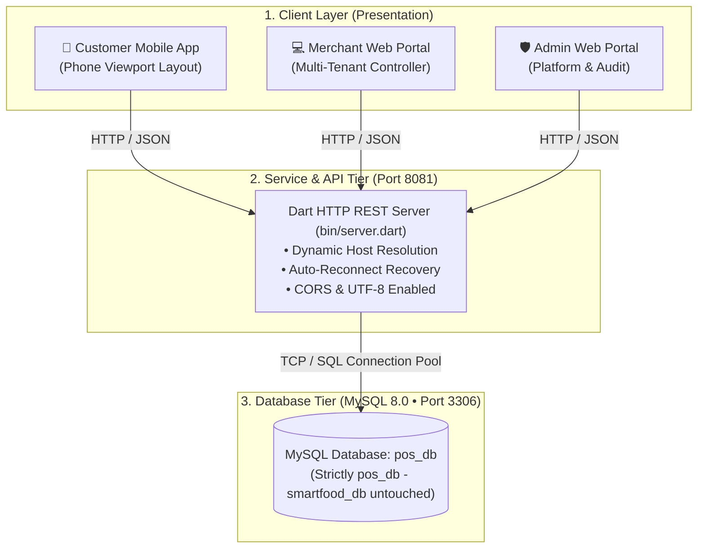
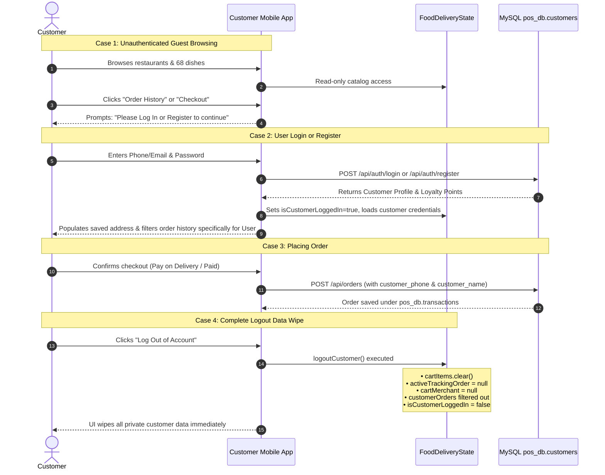
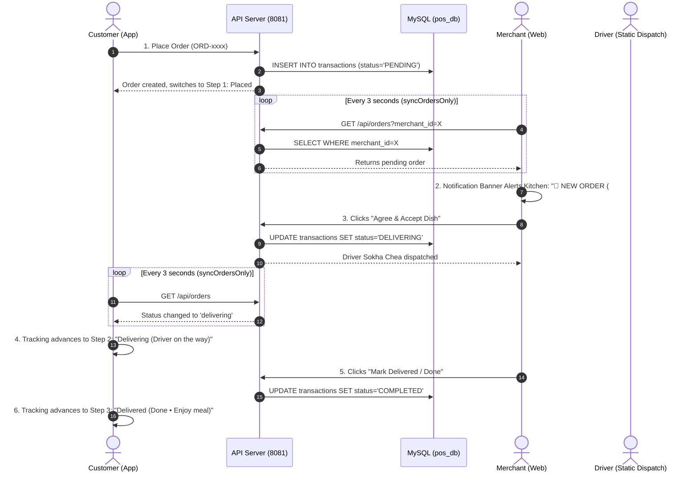

# SmartFood Multi-Tenant Platform Architecture & Process Flow

This document details the architectural process, multi-tenant isolation rules, database design, and end-to-end lifecycle of the **SmartFood Food Delivery & Merchant POS System**.

---

## 1. System High-Level Architecture

The platform consists of three core tiers:



---

## 2. Multi-Tenant Merchant Corporate Account Hierarchy

The system strictly enforces **Corporate Tenant Isolation**. There are **10 Corporate Merchant Accounts**, each owning multiple restaurants. A logged-in merchant can **only view and manage their own restaurants**.

| Account ID | Corporate Merchant Account | Corporate Email | Company Reg # | Assigned Restaurants |
|:---:|:---|:---|:---|:---|
| **#1** | **Angkor Food & Heritage Group** | `angkor.heritage@gmail.com` | `AF-2026-001` | 1. Angkor Authentic Kitchen (`#1`)<br>2. Khmer Heritage Curry House (`#2`)<br>3. Siem Reap Riverside Bistro (`#3`) |
| **#2** | **Brown & Artisan Coffee Ventures** | `artisan.coffee@gmail.com` | `BC-2026-002` | 4. Brown Artisan Roastery BKK1 (`#4`)<br>5. Phnom Penh Specialty Cafe (`#5`) |
| **#3** | **Smash & Patty Burger Labs** | `smash.burger@gmail.com` | `SB-2026-003` | 6. Smash & Patty Burger BKK1 (`#6`)<br>7. Royal Patty Burger Toul Kork (`#7`) |
| **#4** | **Royal Asian Noodle & Dim Sum Co.** | `asian.noodles@gmail.com` | `RN-2026-004` | 8. Royal Asian Noodle Bar (`#8`)<br>9. Golden Dragon Dim Sum House (`#9`) |
| **#5** | **Tokyo Ramen & Sushi Masters** | `tokyo.izakaya@gmail.com` | `TR-2026-005` | 10. Tokyo Tonkotsu Ramen House (`#10`)<br>11. Sakura Sushi & Sashimi Bar (`#11`) |
| **#6** | **Bella Napoli Italian Cuisine** | `bella.napoli@gmail.com` | `BN-2026-006` | 12. Bella Napoli Woodfired Pizza (`#12`)<br>13. Trattoria Roma Pasta Bar (`#13`) |
| **#7** | **Bangkok Wok & Night Market** | `bangkok.wok@gmail.com` | `BW-2026-007` | 14. Bangkok Street Pad Thai (`#14`)<br>15. Siam Spicy Wok & Tom Yum (`#15`) |
| **#8** | **Seoul K-Chicken & BBQ House** | `seoul.kchicken@gmail.com` | `SC-2026-008` | 16. Seoul Crispy K-Chicken (`#16`)<br>17. Gangnam Korean BBQ & Bowls (`#17`) |
| **#9** | **Taj Mahal Spice & Biryani Palace** | `taj.spice@gmail.com` | `TM-2026-009` | 18. Taj Mahal Royal Biryani (`#18`)<br>19. Mumbai Tandoori & Naan (`#19`) |
| **#10** | **Green Vitality & Organic Kitchen** | `green.vitality@gmail.com` | `GV-2026-010` | 20. Green Vitality Salad Bar (`#20`)<br>21. Pure Earth Vegan Bowls (`#21`) |

### Strict Merchant Isolation & Authentication Rules:
1. **Direct Login & Partner Registration**: The merchant portal entrance is a clean authentication interface with a toggle between **Sign In** and **Register Partner** (no corporate account picker grid).
   - **Sign In**: Merchants authenticate with their corporate email (e.g. `angkor.heritage@gmail.com`) or account ID and password (`123456`).
   - **Register Partner**: New merchants create a corporate account and initial restaurant directly in `pos_db.merchant_accounts` and `pos_db.merchants` with seeded initial dishes in `pos_db.products`.
2. **Store Dropdown Isolation**: Upon login, the restaurant switcher in the merchant portal header **only** populates `state.currentMerchantRestaurants` (`WHERE account_id = currentAccount.id`).
3. **Kitchen Order Pipeline Isolation**: Kitchen orders query only transactions matching restaurants owned by that account.
4. **Menu CRUD Isolation**: The merchant cannot see, edit, or delete dishes belonging to other accounts.
5. **Sales Isolation**: Revenue and GMV metrics reflect solely the merchant's own stores.

---

## 3. Customer Multi-User Isolation & Data Privacy Flow



### Complete Logout Data Vanishing:
When a customer logs out, their private session data is wiped clean:
- **Cart Contents**: Emptied completely (`cartItems.clear()`).
- **Live Tracking**: Reset to null (`activeTrackingOrder = null`).
- **Order History**: `customerOrders` returns `[]`. No other user or guest can see past invoices.
- **Saved Address & Phone**: Cleared from memory.

---

## 4. Real-Time Order & Delivery Pipeline



---

## 5. MySQL Database Entity-Relationship (`pos_db`)

```
merchant_accounts (10 Accounts)
  ├── id (PK)
  ├── account_name
  ├── email (UNIQUE)
  ├── phone
  ├── company_reg_number
  └── password (DEFAULT '123456')
       │
       ▼ (1 : N)
merchants (21 Restaurants)
  ├── id (PK)
  ├── account_id (FK -> merchant_accounts.id)
  ├── name & khmer_name
  ├── cuisine, rating, delivery_fee_usd
  └── total_sales_usd
       │
       ├──► (1 : N) products (68 Dishes)
       │      ├── id (PK)
       │      ├── merchant_id (FK -> merchants.id)
       │      ├── name & khmer_name
       │      └── selling_price
       │
       └──► (1 : N) transactions (Customer Orders)
              ├── id (PK)
              ├── invoice_number (UNIQUE)
              ├── merchant_id (FK -> merchants.id)
              ├── customer_id (FK -> customers.id)
              ├── customer_name & customer_phone
              ├── delivery_address
              ├── grand_total_usd
              ├── payment_method (CASH / CREDIT_CARD)
              └── status (PENDING / DELIVERING / COMPLETED)
                   │
                   ▼ (1 : N)
              transaction_items
                   ├── id (PK)
                   ├── transaction_id (FK -> transactions.id)
                   ├── product_id (FK -> products.id)
                   └── quantity & line_total

customers (Customer Accounts)
  ├── id (PK)
  ├── name & phone (UNIQUE)
  ├── email & password
  ├── default_address
  ├── membership_tier (REGULAR / SILVER / GOLD / VIP)
  └── loyalty_points
```

---

## 6. How to Run & Verify

1. **MySQL Service**: `MySQL80` running on `127.0.0.1:3306`.
2. **API Server**: Run with `dart run bin/server.dart` (actively listening on `http://127.0.0.1:8081`).
3. **Web Application**: Access at `http://localhost:8085` (served from `build/web`).
4. **Test Accounts**:
   - **Customer**: `010 334 556` (Bopha Pich) or `098 765 432` (Dara Lim) with pass `123456`, or register any new account.
   - **Merchant**: Select any of the **10 Corporate Accounts** on the Merchant Login screen (pass `123456`).
